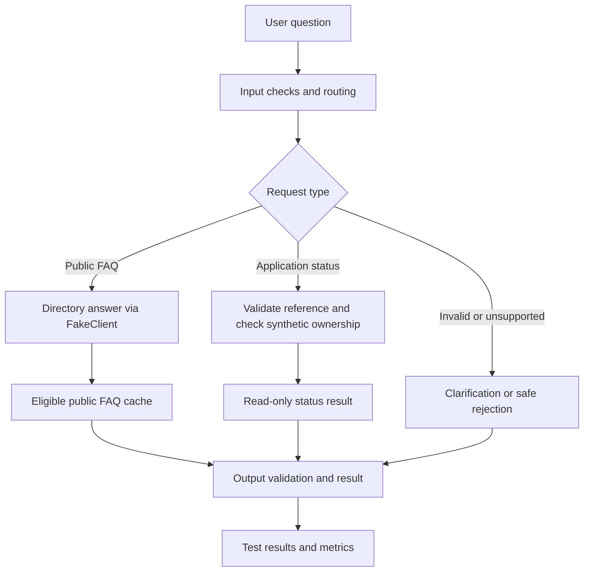
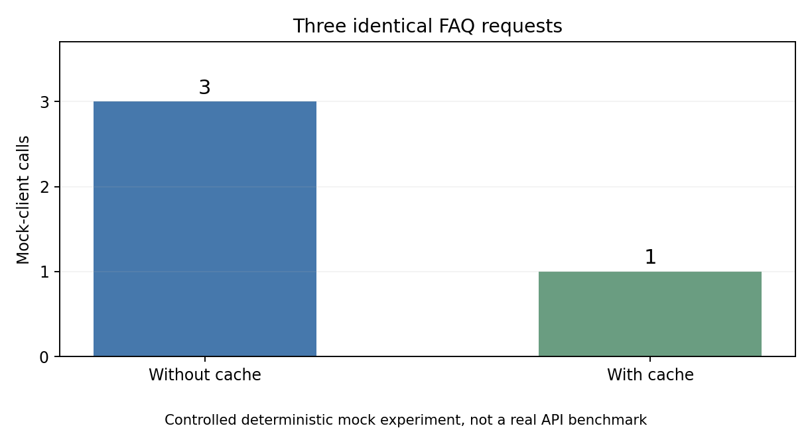

# Murshid Mini | LLM Application Engineering

**Student:** Moudi Alhomoud  
**Course:** LLM Application Engineering (SDA-AIE-213)  
**Instructor:** Meaad Al-Marri  
**Training context:** [SDAIA Academy](https://github.com/SDAIAAcademy)

A small educational application for answering two synthetic public-service FAQs and handling fictional application-status requests. The project demonstrates how to build an application around a model-shaped interface while keeping input checks, authorization decisions, response validation, tests, and caching in Python.

The main Murshid project uses `FakeClient`, a deterministic mock implementation designed to demonstrate LLM application engineering concepts. Homework Days 1 and 4 use `google/flan-t5-small`, a pretrained language model, to demonstrate real-model inference and evaluation on CPU. The project uses synthetic data and is intended for educational purposes.

## Project goals and intended users

Murshid Mini is a teaching prototype for learners studying LLM application engineering. It uses a fictional service directory and application records to explore routing, structured requests, safe access to records, validation, testing, and measurement. It is not intended for actual applicants or real service records.

## Features and scope

- Responds to two predefined FAQs, one Arabic and one English, using synthetic directory text.
- Extracts structured status-request information and asks for clarification when a reference is missing.
- Performs read-only status lookups with synthetic user ownership checks.
- Rejects out-of-scope requests, unsupported actions, selected instruction-override inputs, blank inputs, and invalid response structures.
- Runs a ten-case mock regression set, including expected refusals.
- Caches eligible public FAQ answers using version-aware keys, while excluding private application-status lookups.
- Reports mock-client calls, cache hits, recorded Python execution time, and hypothetical rather than billed API costs.

## How the project works

The diagram summarizes the educational workflow. The Python code in the [cumulative notebook](notebooks/Moudi_Murshid.ipynb) is the source of implementation details.

## Four-day project development

| Day | Work completed | Evidence |
| --- | --- | --- |
| 1 | Synthetic service directory, `FakeClient`, baseline FAQ responses | [Baseline results](results/core/baseline_results.json) |
| 2 | Structured tickets, read-only status checks, synthetic ownership | [Day 2 results](results/core/day2_results.json) |
| 3 | Guardrails, response checks, ten golden test cases | [Day 3 results](results/core/day3_results.json) |
| 4 | Cache experiment, regression checks, metrics, and final report | [Final report](results/core/final_report.json) |

## Run the core notebook

1. Open [notebooks/Moudi_Murshid.ipynb](notebooks/Moudi_Murshid.ipynb) in Google Colab or a Python Jupyter environment.
2. Select Python 3.9 or newer and a CPU runtime.
3. Run the cells from top to bottom. No API key, model download, GPU, or third-party Python package is required for the core project.
4. Inspect the test summaries and the JSON files produced in the runtime's `murshid_outputs/` directory.

The copies of the recorded outputs committed to this repository are under [results/core](results/core/). The notebooks and stored results represent educational runs, not live service requests.

## Example inputs and behaviors

| Example input | Expected behavior |
| --- | --- |
| `How can I check my application status?` | Answer from the fictional English directory |
| `ما حالة طلبي REF-1001 في الرياض؟` | `under_review` for the authorized synthetic user |
| `أريد حالة طلبي` | Request the missing reference number |
| `ما حالة REF-9999؟` | `not_found` |
| `ما حالة REF-1002؟` | `access_denied` for the first demo user |

These are examples from the synthetic exercise, not actual application statuses.

## Results

| Measurement | Recorded result | Meaning |
| --- | --- | --- |
| Day 3 golden tests | 10/10 passed | Ten selected mock cases |
| Day 4 regression tests | 10/10 passed | Same core behaviors after adding caching |
| Mock-client calls without cache | 3 | Three identical public FAQ requests |
| Mock-client calls with cache | 1 | One initial miss followed by two hits |
| Cache-hit rate | 66.7% | Two hits across three controlled requests |
| External model API calls for core | 0 | All core responses are simulated |

The chart compares counts within one controlled mock experiment. It is not evidence of real API savings or a production latency improvement. The ten passing cases measure only the selected test set, not general accuracy or security.

Additional results are in [results/core](results/core/) and the [final report](results/core/final_report.json). `metrics.json` contains execution-level metrics in milliseconds. The hypothetical cost estimate in the final report is illustrative and is not an actual charge.

## Homework assignments

These exercises are **separate** from the cumulative mock project.

| Day | Exercise | Notebook | Result |
| --- | --- | --- | --- |
| 1 | Generate a local real-model answer with FLAN-T5 small | [Day 1 notebook](homework/day1_real_model_Moudi.ipynb) | [Day 1 result](results/day1/live_demo_result.json) |
| 2 | Validate and dispatch structured read-only tool calls | [Day 2 notebook](homework/day2_tools_Moudi.ipynb) | Printed in notebook |
| 3 | Diagnose intentionally rejected inputs | [Day 3 notebook](homework/Moudi_day3_errors.ipynb) | Printed in notebook |
| 4 | Evaluate three paraphrases with a local real model | [Day 4 notebook](homework/Moudi_day4_evaluation.ipynb) | [Day 4 result](results/day4/evaluation_result.json) |

The real-model homework uses `google/flan-t5-small` locally on CPU and downloads its model and Python dependencies. The recorded Day 4 run produced 3/3 **keyword matches** for `reference` and `number`. This is not a semantic accuracy score. No external inference API calls were made.

## Data, implementation, and limitations

The directory and application records are handwritten **synthetic fixtures**. No real applicant information, official service database, or live authentication is used. See [project notes](docs/project-notes.md) for the record fields, pipeline decisions, test explanations, cache rules, and known limitations.

The mock client has finite predefined responses. The input guards are educational rules rather than comprehensive prompt-injection protection. Authorization uses a synthetic session identifier, not real identity verification. The project has not been deployed or tested for production use.

A next step would be to integrate a real authentication mechanism and evaluate a real model on a broader, independently reviewed test set before considering any user-facing deployment.

## Course reference

- [Instructor's Murshid project repository](https://github.com/almiyead-rgb/murshid-llm-application-engineering-sda-aie-213)

This attribution describes the training context and does not imply SDAIA Academy endorsement of this implementation.
